# User guide

This guide is for the person who brings a feature idea to the AI PM: a product owner, a producer or a feature sponsor. You do not need to know anything about the technology behind it. If you run or set up the app, see the [README](README.md) instead.

## What the AI PM does

The AI PM is an AI project manager for the mobile game **Comet Run**, an endless runner built by a Scrum team. You describe a new feature in plain words. The AI PM then:

1. asks you a short questionnaire to understand the idea;
2. analyses the requirements and what they change in the game;
3. assesses the feature: effort, delivery dates, team, budget, business value, risks, and a verdict (**Go**, **Go with conditions** or **No-Go**);
4. writes the project-management documents and, when you ask, publishes them to Confluence;
5. shows you a three-slide proposal;
6. asks for your decision. If you approve, it puts an Epic and its user stories into Jira as a draft for the Product Owner.

**Who decides what.** Every number (dates, costs, return on investment, the verdict) is calculated by the app from the project's data. The AI supplies judgements and the text: which requirements matter, how complex a piece of work looks, what could go wrong. You make the decision. The Product Owner and the team review everything that goes into Jira.

**Everything is preliminary.** The estimates are a first view, not a delivery commitment. They become firm only after the development team estimates the stories itself.

A feature takes about half an hour from request to Jira. Most of that time is the AI working; you spend a few minutes answering and deciding.

## The home page

Open the app in your browser. The home page has:

- **New feature request**: a box where you describe your feature. **Use the example** fills in a sample request; **Send to the AI PM** starts.
- **Recent requests**: every feature so far, with its status (for example _Waiting for your decision_, _Approved_ or _Declined_). Click one to open it.
- **System status** in the dark bar at the top: whether the app can reach everything it needs. See [System status](#system-status).

Click **AI PM** at the top left to come back here from anywhere.

The app follows your computer's light or dark setting. The screenshots in this guide show the dark theme.

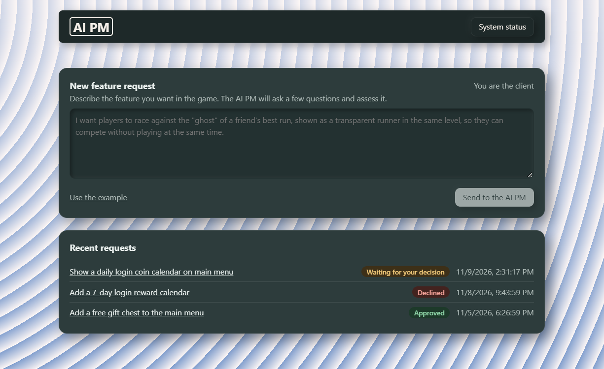

## Step by step

When you open a feature, the step bar at the top shows where it is: **Intake, Discovery, Analysis, Estimation, Documents, Presentation, Backlog**. A step turns green when it is done.

While the AI works, the chat ends with a **"please wait"** card that says what is happening. You can leave the page and come back later; the work goes on without you.

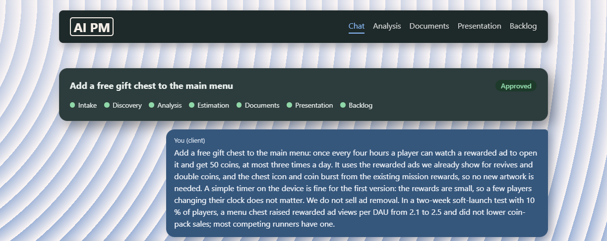

### 1. Describe the feature

Write one or two short paragraphs. Say what the player sees and does, and why you want it. These details make the assessment better:

- **evidence**: analytics, a test result, player requests, what competitors do;
- **constraints**: budget, deadlines, things the feature must not change;
- **reuse**: existing art, systems or features it can build on.

For example: _"Add a free gift chest to the main menu: once every four hours a player can watch a rewarded ad to open it and get 50 coins, at most three times a day. It uses the rewarded ads we already show. In a two-week test with 10 % of players, a menu chest raised rewarded ad views per player from 2.1 to 2.5."_

The AI PM replies with its understanding of your idea and gives the feature a short name.

### 2. Answer the discovery questionnaire

The questionnaire has 10 fixed questions in five areas (business justification, product context, scope, feasibility and decision readiness), plus up to 2 questions about your feature. It takes about three minutes.

- Most answers are predefined options. Some options open a small field for details, such as a KPI target.
- If you do not know an answer, pick **Not yet determined**. The AI PM records it as an open point. It never turns a guess into a fact.
- Press **Send answers** when you are done.

### 3. Read the Discovery Completeness Report

The AI PM checks your answers for gaps and contradictions, then shows a report:

- the result: _Complete_, _Complete with assumptions_, _Needs clarification_ or _Insufficient_;
- each area as covered, partial or missing;
- what is **confirmed by you**, what is **your assumption**, what is an **AI hypothesis**, and what is **missing**;
- a confidence level.

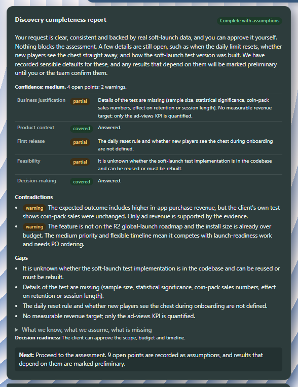

If something important is unclear or contradictory, you get a short **clarification** round with a few extra questions. If something still blocks the assessment after that, the AI PM asks **How do you want to continue?**:

- **Continue with a preliminary assessment**: the open points are filled with documented assumptions, and every figure that depends on them is marked preliminary;
- **Stop for now**: the feature stops here.

### 4. Wait for the analysis and the assessment

Nothing to do here. The AI PM analyses the requirements and their impact, then estimates the feature. This takes about five minutes.

The **Assessment ready** card shows the verdict and the headline figures: delivery dates, cost, return on investment and the number of risks. Press **Open the Analysis tab** for the full picture (see [The tabs](#the-tabs-of-a-feature)).

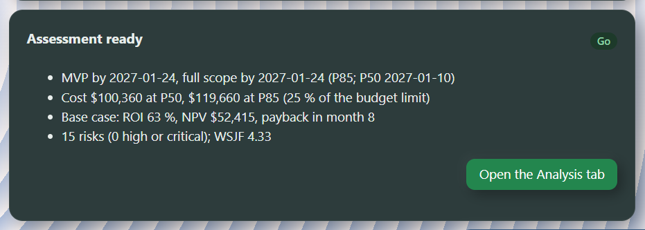

### 5. Documents

The **Documents** card lists the documents for your feature:

- **Feature Brief**: the feature's main page;
- **Requirements Specification**;
- **Estimation & Release Forecast**;
- the feature's entries in the shared **Risk Register** and **Assumption Log**;
- a **Roadmap Update Proposal**, only when the feature changes the roadmap.

You have three buttons:

- **Generate documents** writes them. It takes a few minutes. Then each row has a **Preview**, and the AI PM moves on to the proposal by itself.
- **Publish to Confluence** puts them on your Confluence space, with an **Open in Confluence** link per document. You can publish at any time after generating, even after your decision, but only once. Publishing is **required to approve** the feature.
- **Skip for now** goes straight to the proposal without documents. You can still decline without them. To approve, you will have to generate and publish them at the decision step.

Each button disappears once its step is done. There is no second generation and no re-publish.

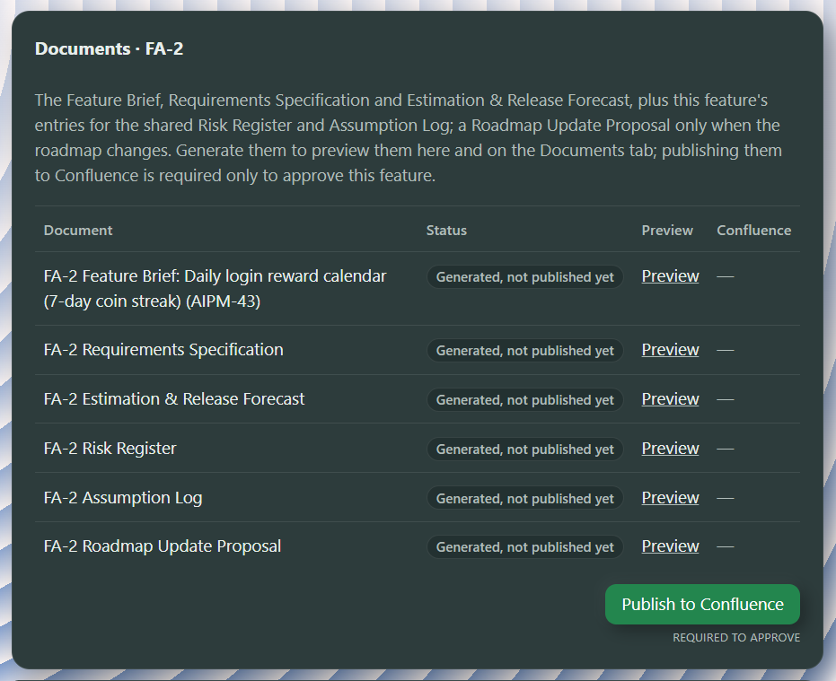

### 6. The proposal

The **Proposal** card holds a three-slide presentation:

1. the business opportunity;
2. the solution and its scope;
3. delivery feasibility and the recommendation.

It shows dates and money as ranges, marks every slide **preliminary** and "not a delivery commitment", and leaves out team-internal measures such as story points.

- **View slides** opens the slides in the app.
- **Download PPTX** saves a PowerPoint file.
- **Publish to Confluence** (optional) attaches the presentation to the Feature Brief and shows it on that page. It is available once, after the documents are published.

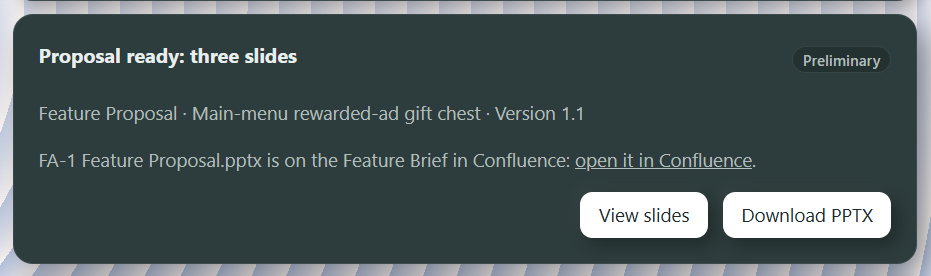

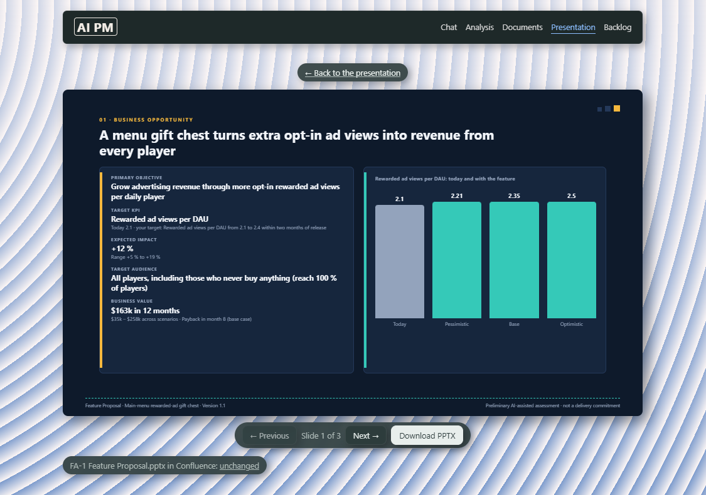

### 7. Decide

The AI PM writes _"Here is the assessment summary. Do you want to go ahead with this feature?"_ with the key figures. Below it is the decision card: an optional comment for the team, **Decline** and **Approve**.

- **Approve** needs the documents published. Until they are, the button is locked and shows _"Publish the documents to proceed."_ If you click it anyway, the chat tells you what to do: generate and publish the documents, or only publish them. You can do that on the Documents card or the Documents tab, then press **Approve** again.
- **Decline** works at any time, with or without documents.

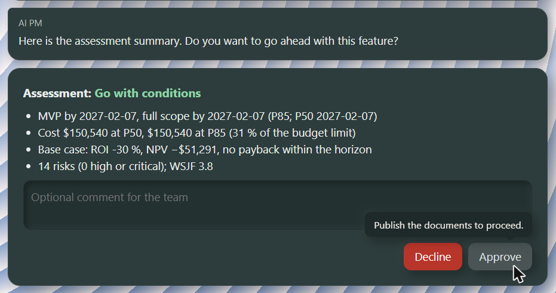

The decision is final for this request. If you want a changed version of the feature, start a new request.

### After you approve

- The AI PM writes the **Epic** and one **user story** per piece of work into Jira, as an **AI draft**:
  - status To Do, label `ai-draft`, not in any sprint;
  - Story Points left empty, for the team to fill in;
  - a proposed priority and an AI estimate, both waiting for the Product Owner's review;
  - acceptance criteria in a Given / When / Then format, and links between stories that block each other.
- The **Initial Product Backlog** page in Confluence lists the new Epic, and the Feature Brief records your approval and links the Epic.
- A **Backlog** tab appears on the feature with the Epic and every story.
- The step bar turns all green, the status reads **Approved**, and the conversation closes.

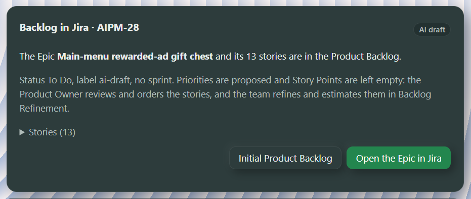

The Product Owner then reviews and orders the stories, and the team refines and estimates them in Backlog Refinement.

### After you decline

- Your decision is recorded on the Feature Brief and the Assumption Log, if they are published.
- The draft Epic in Jira is closed. Nothing goes to the backlog.
- The Backlog step turns red, the status reads **Declined**, and the conversation closes.

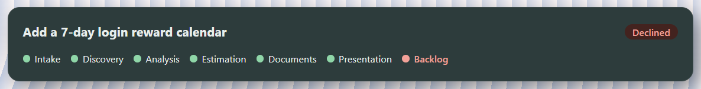

## The tabs of a feature

The dark bar at the top of a feature has these tabs:

- **Chat**: the whole conversation, one card per step.
- **Analysis**: the assessment in detail. Under the feature's name you see the size of the change (for example a feature extension, or a change to the game's core) and, when it applies, a _Preliminary_ banner with the reasons. Most sections have a chart and a table:
  - **Verdict**, with the reasons and any conditions;
  - **Planning inputs**: when the work could start, the team's share and speed, the cost per sprint, and any deadline;
  - **Release forecast**: likely delivery dates at P50 and P85;
  - **Story map**: the pieces of work, with the minimum first release (MVP) marked;
  - **Resources** and **Budget**;
  - **Risks**: each risk with its likelihood and impact;
  - **Business value**: pessimistic, base and optimistic scenarios, return on investment, and a priority score (WSJF).
- **Documents**: the same documents as the Documents card, with full previews.
- **Presentation**: the slide viewer and the PowerPoint download.
- **Backlog**: the Epic and its stories in Jira. It appears only after an approval.

The top of the **Analysis** tab: the headline figures, the verdict and the planning inputs.

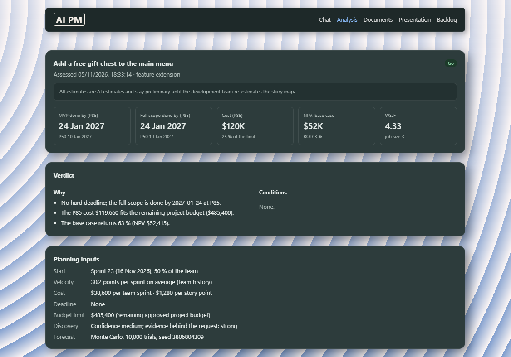

Further down, each section pairs a chart with a table, here the release forecast:

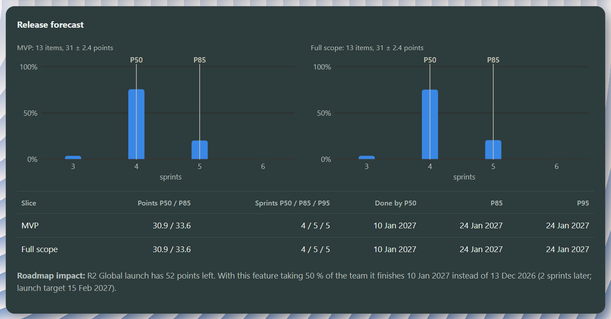

## System status

**System status** shows:

- **Health checks**: whether the app can reach its database, Jira, Confluence and Claude (the AI). Everything should read OK. If a check fails, tell your administrator.
- **Project baseline · Comet Run**: the project documents the AI PM reads before it assesses a feature (business case, roadmap, team and velocity, risk register and others), with links to Confluence.
- **Run log**: every feature with its steps, how long each took, and how much AI work it used.

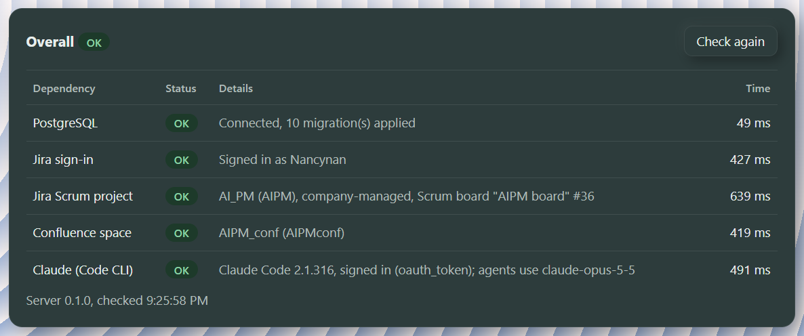

## Good to know

- **Nothing is lost.** Every feature is saved. If the app restarts, an interrupted step starts again by itself.
- **AI usage limits.** If the AI reaches its usage limit, the current step shows _Paused_ and continues by itself once the limit resets.
- **Once only.** Documents and the presentation are published to Confluence once. Pressing a button twice never creates a second page or issue.
- **What the AI does not decide.** It does not approve features, does not plan sprints and does not set story points. You approve, the Product Owner orders the backlog, and the team estimates the work.
- **Answer honestly.** _Not yet determined_ is a good answer when it is true. Open points go into the Assumption Log and are marked in the assessment, so nobody mistakes a guess for a fact.

## Glossary

| Term                    | Meaning                                                                                                            |
| ----------------------- | ------------------------------------------------------------------------------------------------------------------ |
| **Epic**                | A large piece of work in Jira that groups the user stories of one feature.                                         |
| **User story**          | One small, valuable piece of the feature, written from the player's or the business's point of view.               |
| **Acceptance criteria** | The conditions a story must meet to count as done, written as _Given … When … Then …_.                             |
| **MVP**                 | Minimum viable product: the smallest first release that still delivers the feature's main value.                   |
| **P50 / P85**           | Delivery dates with a 50 % and an 85 % chance of being met. P85 is the safer date to plan with.                    |
| **ROI**                 | Return on investment: how much the feature earns back compared with what it costs.                                 |
| **NPV**                 | Net present value: the feature's expected gain in today's money. Below zero means it costs more than it brings in. |
| **WSJF**                | Weighted shortest job first: a priority score. Higher means more value for less time.                              |
| **Go**                  | The assessment supports building the feature as described.                                                         |
| **Go with conditions**  | Worth building, but only if the listed conditions are met first (for example, a roadmap conflict resolved).        |
| **No-Go**               | The assessment does not support building the feature now.                                                          |
| **Preliminary**         | Based on assumptions or AI estimates that the team has not checked yet. Not a delivery commitment.                 |
| **AI draft**            | Jira issues written by the AI PM and waiting for the Product Owner's review (label `ai-draft`).                    |
| **Product Owner (PO)**  | The person who owns the product backlog and decides the order in which the team works on it.                       |
| **Backlog Refinement**  | The team meeting where stories are clarified, split and estimated before a sprint.                                 |
