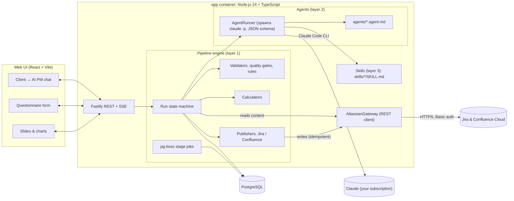
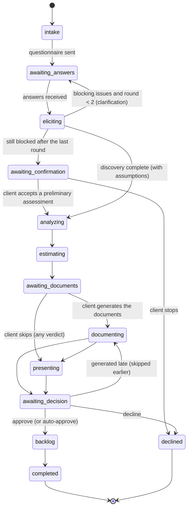
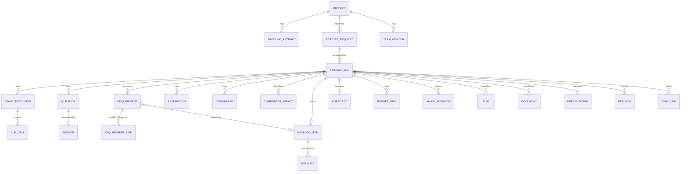

# AI PM Pipeline: implementation plan

> Status: decisions confirmed on 2026-11-02 (see [section 16](#16-decisions)). Phases 0–3 done on 2026-11-03, Phase 4 on 2026-11-05, Phases 5 and 6 on 2026-11-06, Phase 7 on 2026-11-07, Phase 8 on 2026-11-08 (the live demo run by the user by hand). Sprint event reminders by email (the former Phase 8) were dropped on 2026-11-07. Process models: [docs/bpmn](bpmn/README.md) (open `bpmn/viewer.html`).
>
> The code lives in `ai_pm/source/`, the GitHub repository `nancynaan/ai_pm`. These design docs stay inside the repository, in `./docs/`.

## 1. Goal

A locally run (Docker Compose) Node.js/TypeScript service with a simple web UI. A **client** describes a new feature for an endless-runner game that is already in development. An **AI PM bot** then does the following:

1. Extracts requirements, finds missing information and asks a **short questionnaire with predefined answers** (at most 8 questions).
2. Categorizes requirements (FR/NFR), finds conflicts, dependencies, assumptions and constraints, and classifies the change: *UI skin*, *feature extension* or *core engine* (for example physics).
3. Estimates effort, release forecast, resources, budget, business value/ROI and risks.
4. Generates the PM artifacts and publishes them to **Confluence**.
5. Shows the client a short **presentation** with a few simple charts.
6. After the client approves, creates the **Epic, user stories, acceptance criteria, dependencies and priorities in Jira** as an AI draft for Product Owner review (part of the Product Backlog, never in a sprint).

The Backlog Refinement and sub-task creation stay human. The pipeline sends no email and no sprint event reminders.

Every piece of data the pipeline gathers or produces is stored in a local **PostgreSQL** database for later use.

## 2. Mismatches found in the brief and how this plan resolves them

| # | Observation | Resolution in this plan |
|---|---|---|
| M1 | The PO *writes the Epic*, yet the final delivery says the Epic is *generated automatically*. | The pipeline creates a **draft Epic at intake** on the PO's behalf (label `ai-pm`) and **completes it at backlog generation** (description, value, links). |
| M2 | Stories are generated in the last step, but you can't estimate effort without breaking the feature down first. | Estimation drafts a **story map** (candidate stories and spikes with stable IDs). Backlog generation later **turns the same items into full stories**, so the estimates, the documents and Jira stay consistent. |
| M3 | A scope statement, a schedule and a traceability matrix are predictive artifacts, but the project is Scrum. | Lightweight, Scrum-adapted documents (§10): a *Feature Brief* with the scope instead of a scope statement, and a *Release Forecast* (velocity-based, P50/P85) instead of a Gantt schedule. No traceability matrix: the story map links requirements to stories in the database, and Phase 7 checks that every requirement is covered by at least one story. |
| M4 | "Does it require rewriting the physics or is it a UI skin?" needs a technical component inventory, which is **not among the listed baseline artifacts**. | The seed adds an **Architecture Overview** page (component map) to the baseline. |
| M5 | Budget and ROI need numbers: KPI baseline (DAU, ARPDAU, retention), team rates and velocity history. A new free-plan Jira project has no closed sprints. | The seed puts a numeric **KPI baseline** in the Business Case and adds a **Team & Velocity** page (rates, capacity, velocity history). Once real sprints close, their velocity replaces the seeded history. |
| M6 | In Scrum terms, "Demo" is the **Sprint Review**. Daily Scrum isn't listed. | The pipeline does not touch Scrum events: reminders before Planning, Refinement, Review and Retro were planned and then dropped (2026-11-07). |
| M7 | "Roadmap update?" The roadmap belongs to the PO. | The pipeline writes a **Roadmap update proposal** page marked *Proposed*. It sets Epic target dates and fixVersion only after the client approves. |
| M8 | In Scrum, the Developers estimate. | AI estimates go into a separate **"AI estimate (SP)"** field, and every generated issue carries the `ai-draft` label. The team's Story Points (Planning Poker) remain authoritative. |
| M9 | The brief asked for Jira/Confluence "by MCP", but every write already goes through deterministic pipeline engine code. | **Direct REST API** (confirmed): a typed client over Jira REST v3, the Jira Agile API and Confluence REST v2. The pipeline engine fetches the data agents need and puts it into their prompts; agents get no tools. No MCP container. |
| M10 | A client approval step is implied but not stated. | Add a **client decision gate** (Approve / Decline; revised in Phase 7, there is no "request changes") before Jira stories are created, with an auto-approve switch for demos. |

## 3. Key design decisions

| ID | Decision | Why |
|---|---|---|
| D1 | **The pipeline engine owns the flow.** A deterministic TypeScript state machine runs the stages. Agents never decide what happens next; they return JSON validated against a schema. | Reproducible runs, resumable after crashes, testable, auditable. This is the "production pipeline" part. |
| D2 | **Claude through the Claude Code CLI on your Claude subscription; no Anthropic API key** (confirmed). Each agent call spawns `claude -p` with `--system-prompt`, `--json-schema`, `--output-format json`, `--model`, `--effort` and `--tools ""`. In Docker the image ships a pinned Claude Code, signed in with `CLAUDE_CODE_OAUTH_TOKEN` from `claude setup-token`; on the host the existing Claude Code login is used. | No API billing, and it uses the same mechanism as your coding orchestrator. Fixed stages with structured outputs are a *workflow*, so print mode with a JSON schema is enough. With all tools switched off, untrusted client text never reaches a shell or file tool. Trade-offs: runs share the subscription's usage limits with your other Claude Code work, and the setup is meant for personal use, not a product for other people. |
| D3 | **Skills use the Agent Skills format** (`skills/<name>/SKILL.md` + `references/`). The pipeline engine puts an agent's declared skills, and the reference files the stage needs, into its system prompt. | The same skills work interactively in Claude Code. Knowledge (methods, templates, rubrics) is kept apart from prompts and code. |
| D4 | **Atlassian through the REST API.** An `AtlassianGateway` with typed methods over Jira REST v3, the Agile API 1.0 and Confluence REST v2 (v1 only for attachments and labels), authenticated with Basic auth (email + API token from `.env`). **Writes** happen only in the pipeline engine, with idempotency keys and a dry-run mode. **Reads** happen in the pipeline engine too: it fetches the Jira and Confluence data a stage needs and puts it into the agent's prompt. | Full API coverage (issue descriptions in ADF, custom fields, bulk create, links, sprints, page versions, attachments), fewer moving parts, safer scope. An MCP adapter could implement the same interface later if you want that story for a demo. |
| D5 | **No arithmetic in the model.** PERT, Monte Carlo, budget, EMV, ROI/NPV/payback, WSJF and the feasibility rules are all TypeScript. Agents supply judgements (sizes, probabilities, value drivers) and narrative. | Numbers that are correct and reproducible and match across every document. |
| D6 | **PostgreSQL + Drizzle ORM + pg-boss.** pg-boss is a Postgres-backed job queue. Everything is persisted: runs, stage I/O, LLM calls (tokens, cost), requirements, estimates, risks, documents, presentations, the Jira backlog and the Jira/Confluence sync log. | One stateful dependency. Human waits survive restarts. Data is kept for later analytics and calibration. |
| D7 | **Model: `claude-opus-5-5` for every agent** (confirmed), passed with `--model`. Effort is tuned per stage (`low`, `medium` or `high`) with `--effort`. | Best quality everywhere. The model stays configurable per agent in `agents/*.agent.md`. |
| D8 | **Single source of truth.** Documents and slides are rendered from DB data. A validator checks that every figure in a document equals the DB value. | No drift between the documents, the estimates, the slides and Jira. |
| D9 | **The BPMN models are documentation, not executed.** | A BPMN engine (Camunda/Zeebe) would be overkill for a pet project. The state machine mirrors the models, and an engine can be added later. |

## 4. Architecture



### 4.1 Layers

| Layer | Folder | Contains | Rules |
|---|---|---|---|
| **Pipeline engine** | `apps/server/src/pipeline-engine` | State machine, stage handlers, job queue, gates/validators, calculators, publishers, event bus | Deterministic. The only layer that writes to Jira/Confluence/DB. Owns retries, idempotency and budgets. |
| **Agents** | `agents/*.agent.md` + `apps/server/src/agents` (runtime) | One file per role: frontmatter (model, effort, skills, context inputs, output schema) + system prompt. `AgentRunner` executes them. | Input: a context object built by the pipeline engine. Output: JSON validated against a zod schema. No side effects. |
| **Skills** | `skills/<name>/` | `SKILL.md` (procedure, checklists, rubrics) + `references/` (question bank, templates, scales) | Plain knowledge, versioned in git and reusable from Claude Code. |
| **Integrations** | `apps/server/src/integrations` | `AtlassianGateway` (REST), the Claude Code CLI | Typed, mockable, with a dry-run mode. |

### 4.2 Run lifecycle



Any state can move to `failed`. The run resumes from the last successful stage checkpoint. Each stage is a pg-boss job keyed by `(runId, stage, attempt)`. Stage input and output are stored in `stage_executions`, and progress events go to the UI over SSE.

### 4.3 How an agent call works (AgentRunner)

1. The pipeline engine builds a typed context from the DB and from Jira/Confluence: requirements, answers, a digest of the baseline, and whatever backlog or page data the stage needs.
2. The system prompt is assembled as *agent prompt + SKILL.md bodies + project baseline digest* and passed with `--system-prompt`. The run-specific context goes into the prompt.
3. The runner spawns `claude -p` with `--json-schema` (generated from the zod output schema), `--output-format json`, `--model claude-opus-5-5`, `--effort`, `--tools ""` and `--no-session-persistence`.
4. Validation: zod first, then semantic checks (IDs exist, ranges are sane). If either fails, the runner sends **one repair prompt** with the error list, at most twice, and otherwise fails the stage.
5. Accounting: the token usage reported in the CLI's JSON output is written to `llm_calls` (tokens, latency, model, prompt hash).
6. Usage limits: if the subscription limit is reached, the stage is **paused**, not failed. The run continues automatically once the limit resets, and the UI says so.
7. Client text is wrapped as untrusted data, and no agent has tools.

One full run is about 10–15 Claude calls with large prompts. It costs nothing extra on top of the subscription but counts against its usage limits, which your coding orchestrator also uses. The real number gets measured in Phase 2.

## 5. Repository structure

```text
source/                        # GitHub repository nancynaan/ai_pm (design docs stay inside, in ./docs)
├── CLAUDE.md                  # how to work on this repo with Claude Code
├── .claude/                   # dev harness: settings.json (permissions), hooks (format on edit, quality gate)
├── README.md                  # setup incl. Atlassian preparation and API token
├── docker-compose.yml
├── Dockerfile                 # multi-stage: build web + server → node:24-slim runtime
├── .env.example               # committed template
├── .env                       # real credentials, git-ignored and docker-ignored
├── package.json               # npm workspaces
├── apps/
│   ├── server/src/
│   │   ├── pipeline-engine/
│   │   │   ├── stages.ts              # states and transitions (state machine)
│   │   │   ├── engine.ts              # the pipeline engine: runs stage jobs, locks, retries, pauses
│   │   │   ├── stages/                # intake, elicitation, analysis, estimation, documents, presentation, backlog
│   │   │   ├── gates/                 # questionnaire, analysis, document, INVEST/DoR validators; feasibility rules
│   │   │   ├── calculators/           # pert, monte-carlo, resources, budget, risk, roi, wsjf (pure functions)
│   │   │   └── events.ts              # SSE event bus
│   │   ├── agents/                    # AgentRunner (spawns claude -p), registry (loads ../../agents), skill loader, context builders
│   │   ├── integrations/
│   │   │   ├── atlassian/             # http client (auth, retries, 429), jira.ts, agile.ts, confluence.ts
│   │   │   └── claude-cli.ts
│   │   ├── render/                    # markdown templates → Confluence storage, chart data, PPTX (pptxgenjs)
│   │   ├── db/                        # drizzle schema, migrations, repositories
│   │   └── api/                       # fastify routes (REST + SSE)
│   └── web/src/                       # React UI: chat, questionnaire, progress, slides, backlog preview
├── packages/shared/                   # zod schemas & types shared by server and web
├── agents/                            # elicitation.agent.md, requirements-analyst.agent.md, …
├── skills/                            # requirements-elicitation/, agile-estimation/, …
├── config/                            # discovery.yaml, feasibility-rules.yaml
├── seed/baseline/                     # baseline artifacts of the demo game (markdown + json)
└── evals/                             # sample feature requests + graders
```

## 6. Agents

All agents run on `claude-opus-5-5`.

| Agent | Stage (BPMN) | Skills | Context the pipeline engine provides | Output schema | Effort |
|---|---|---|---|---|---|
| `elicitation` | 01 | requirements-elicitation, game-domain | Raw client text, baseline digest, the fixed discovery questions | `ElicitationResult` (restatement, candidate requirements, feature gaps, 0–2 feature questions) | medium |
| `discovery-review` | 01 | discovery-completeness, requirements-elicitation, game-domain | Answers, rule findings (classified answers, gaps, contradictions, evidence, readiness) | `DiscoveryReview` (findings by kind, extra gaps and contradictions, assumptions, clarification questions, summary) | medium |
| `requirements-analyst` | 02 | requirements-analysis, game-domain | Answers, current backlog (JQL), GDD, DoD | `RequirementsAnalysis` (FR/NFR, MoSCoW, MVP, conflicts, assumptions, constraints) | high |
| `impact-analyst` | 02 | impact-analysis, game-domain | Architecture Overview, roadmap, Jira components | `ImpactAnalysis` (component impacts, dependencies, spike proposal) | high |
| `estimator` | 03 | agile-estimation | Analyzed requirements, reference stories with points | `StoryMap` (items with O/M/P story points, rationale) | high |
| `risk-analyst` | 03 | risk-management | Analysis results, current Risk Register | `RiskAssessment` (cause/event/effect, P, I, response, owner, trigger, cost impact) | high |
| `value-analyst` | 03 | business-value-roi | KPI baseline, answers | `ValueDrivers` (3 scenarios of driver assumptions, WSJF inputs) | high |
| `pm-writer` | 04 | pm-artifacts, game-domain | All of the run's data, the templates and the figure list | `DocumentDraft` (the text of every document in one answer, with `{{figure:key}}` placeholders) | medium |
| `presenter` | 05 | client-presentation, game-domain | The run's data and the figures the slides show | `DeckDraft` (wording of the three slides: headings, player flow, four capabilities, scope boundary, dependencies, suggested verdict) | medium |
| `backlog-builder` | 06 | user-story-writing, jira-conventions, game-domain | Story map, requirements, the Requirements Specification (user flows, rules, draft acceptance criteria), existing backlog | `BacklogDraft` (Epic overview and outcome; per story-map item: summary, Connextra statement, context, Gherkin scenarios, blockers, open questions; code sets priority, estimate, labels and links) | medium |

No agent has tools: the pipeline engine fetches Jira and Confluence data, limited to the configured project and space, and puts it into the prompt. The writer fills `{{figure:key}}` placeholders. The pipeline engine substitutes the real numbers from the DB, so the model never types a number into a document.

## 7. Skills

| Skill | Main content | Used by |
|---|---|---|
| `requirements-elicitation` | What the fixed discovery questionnaire covers, intake procedure, feature-specific topics and rules (at most 2, never technical estimates) | elicitation, discovery-review |
| `discovery-completeness` | Discovery areas, information kinds (confirmed, client assumption, AI hypothesis, missing), contradiction patterns, when to ask vs. assume, result meanings | discovery-review |
| `requirements-analysis` | FR/NFR taxonomy (ISO/IEC 25010), MoSCoW rules, MVP slicing, conflict/duplicate checklist, `REQ-FR-###` / `REQ-NFR-###` IDs | requirements-analyst |
| `game-domain` | Endless-runner core loop, glossary, KPI glossary (DAU, ARPDAU, D1/D7/D30, LTV), typical NFRs (60 FPS, memory, battery, load time, offline) | elicitation, analyst, impact |
| `impact-analysis` | How to read the component map, change-magnitude rubric (UI/cosmetic, extension, core engine), dependency types, when to propose a spike | impact-analyst |
| `agile-estimation` | Story mapping, Fibonacci scale, reference stories, three-point guidance, splitting patterns | estimator |
| `risk-management` | Cause-event-effect statements, 1–5 probability/impact scales with definitions, response strategies, typical game-dev risks | risk-analyst |
| `business-value-roi` | Value drivers, scenario construction, sanity bounds for uplift, WSJF scoring guide | value-analyst |
| `pm-artifacts` | What each text slot of the five documents says, figure citation rules, style; `templates/*.md` (read by code and shown to the writer) | pm-writer |
| `client-presentation` | The three-slide storyline, conclusion headings, no numbers or story points in wording, hypotheses vs. promises, verdict consistency | presenter |
| `user-story-writing` | INVEST, Connextra format, Gherkin AC, NFRs as AC, spikes and enablers, DoR checklist | backlog-builder |
| `jira-conventions` | What the Epic and stories contain, which fields the engine sets (ai-draft, To Do, no sprint, proposed priority, AI estimate; Story Points empty), Jira writing style | backlog-builder |

## 8. Questionnaire design

**Purpose.** Discovery must uncover five things before anything is estimated: **business justification** (why the feature matters, which outcome the client expects, on what evidence), **product context** (who it is for, which problem it solves), **scope expectations** (what the client expects in the first release, how success is judged), **feasibility constraints** (priority and timing, budget, capacity, dependencies, limitations) and **decision-making readiness** (whether the client can approve scope and investment).

**Format.** Ten fixed core questions (`config/discovery.yaml`), so every feature is assessed on the same basis, plus up to two feature-specific questions from the elicitation agent and an optional free-text comment. Questions are single choice, multi choice with an optional limit ("select up to two"), with exclusive options ("Not yet determined", "No known constraints"), mutually exclusive pairs (fixed vs. flexible budget, fixed date vs. flexible timeline), and detail fields ("Other", "a specific KPI target", "which release or date?"). The client is never asked for effort, cost or uplift numbers.

| # | Area | Question | Kind | Feeds |
|---|---|---|---|---|
| 1 | Business justification | Primary problem or opportunity | single | Value model, problem statement |
| 2 | Business justification | Main business outcome expected | up to 2 | KPI of the value model (client assumption) |
| 3 | Business justification | Basis for the request (analytics, player requests, reviews, competitors, strategy, intuition, none) | multi | Evidence strength; unvalidated hypotheses |
| 4 | Product context | Audience that benefits most | single | Reach, value scenarios |
| 5 | Scope | What the first version should include | multi | MVP proposal |
| 6 | Scope | How success is defined | up to 2 | Business-case acceptance criteria |
| 7 | Feasibility | Priority and timing | single | Schedule recommendation, time criticality |
| 8 | Feasibility | Budget, timeline, technical and organizational constraints | multi | Feasibility rules, constraints |
| 9 | Feasibility | Known dependencies and external factors | multi | Risks, impact analysis cross-check |
| 10 | Decision readiness | Approval status | single | Decision gate, stakeholders |

**Information kinds.** Every finding is labelled **confirmed** (the client stated it), **client assumption** (expected outcomes and success effects; with no or weak evidence an *unvalidated business hypothesis* in the Assumption Log), **AI hypothesis** (inferred by an agent, to be validated by the team) or **missing**. "Not yet determined" or "No supporting evidence" never becomes a fact; it becomes a gap plus a documented default.

**Discovery Completeness Report.** After submission, rules in code classify the answers, compute coverage per area, find contradictions (for example *critical priority with a flexible timeline*, *critical with a fixed budget and limited capacity*, *a fixed date with a low priority*) and gaps, and judge evidence and approval authority. The discovery-review agent adds what rules cannot see (description vs. answers, comments, feature questions). The report shows coverage, contradictions, gaps, findings by kind, a confidence level with reasons, decision readiness and the next action.

| Result | Meaning | Next |
|---|---|---|
| complete | All areas answered, consistent, evidence-backed | Analysis |
| complete with assumptions | Nothing blocking; open points recorded as assumptions | Analysis, dependent results marked preliminary |
| needs clarification | Blocking contradiction or critical gap | One clarification round (at most 4 questions, predefined answers) |
| insufficient | Still blocked after the last round | Client decides: preliminary assessment or stop |

Estimates use the client's expectations and constraints as inputs only; effort and cost come from the baseline and the team, and stay preliminary until the development team validates them.

## 9. Calculations (pipeline engine)

| Output | Method |
|---|---|
| Item estimate | PERT: E = (O + 4M + P)/6, σ = (P − O)/6, in story points |
| Release forecast | Monte Carlo with 10,000 trials and a seeded RNG. Scope comes from each item's beta-PERT distribution. Velocity is resampled from the last *n* closed sprints in Jira, or from the seeded Team & Velocity history while there are none, × the capacity share for this Epic. Outputs: P50/P85/P95 sprint counts → dates on the sprint calendar. |
| Resources | Each story-map item has a discipline (gameplay = all Unity client code, backend, UI/art = design and art, QA). Per discipline: share of points, FTE demand vs. FTE available at the capacity share, and its own duration. The forecast never runs faster than the busiest discipline (critical-resource constraint), so the discipline that sets the pace is shown as information, not a condition. |
| Budget | Labour (roles × sprints × rates at P50 and P85) + non-labour (one-off, and monthly × horizon) + **contingency = Σ risk EMV** (probability × cost impact), **capped at 30 % of labour P50** because overlapping risks and the P85 forecast double-count |
| Risk | Score = P × I on 1–5 scales. High ≥ 15, critical ≥ 20. |
| Value | The value analyst sets KPI changes and reach per scenario within benchmark ranges (not the client's hopes; no evidence → pessimistic = no effect). Code turns them into DAU and ARPDAU effects with configured elasticities and caps, on the baseline DAU before the global launch and the Business Case target after it, ramped over 2 months, from the month after the MVP at P50, over 12 months. Also the break-even share of the base effect. |
| ROI / NPV / payback | ROI = (Σ benefit − cost)/cost. NPV uses a monthly discount rate. Payback is the first month the cumulative cash flow reaches ≥ 0. |
| WSJF | (business value + time criticality + risk reduction/opportunity enablement) / job size, on Fibonacci scales |
| Verdict | Rules in `config/feasibility-rules.yaml`. **No-Go**: even the MVP misses a hard deadline at P85, *or* the P85 cost is more than 1.25 × the budget limit (the client's limit, else the remaining approved budget), *or* a critical risk is accepted without mitigation, *or* the optimistic value case does not cover the cost. **Go with conditions**: only the MVP meets the deadline (or only at P50), the cost is over the limit by at most 25 %, high or critical risks need responses, the base case does not pay back, the outcome is an unvalidated hypothesis, a spike or a blocking conflict is open, the current release slips past its target, someone else must sign off, or the discovery was incomplete (then also *preliminary*). Otherwise a plain **Go** with no conditions. Every verdict keeps the standard next step: the team re-estimates the story map. |

**Seed team and rates** (`seed/baseline/data/team.yaml`, part of the project baseline; USD, 2-week sprints = 80 h per full-time person; all values are editable):

| Role | FTE | Rate (USD/h) | Cost per sprint |
|---|---|---|---|
| Product Owner | 1 | 75 | $6,000 |
| Scrum Master | 1 | 70 | $5,600 |
| Gameplay developer | 2 | 80 | $12,800 |
| Backend developer | 1 | 85 | $6,800 |
| UI/UX & 2D artist | 1 | 65 | $5,200 |
| QA engineer (shared) | 0.5 | 55 | $2,200 |
| **Team total** | **6.5** | | **$38,600** |

Seeded velocity history: 28, 32, 30, 26, 34, 31 story points over the last six sprints. The capacity share for a new Epic defaults to 50 % of the team.

## 10. Generated artifacts (Confluence)

Scrum keeps the document set small (revised in Phase 5): three pages per feature, a fourth only when the roadmap changes, and this feature's entries on two shared pages. The client publishes them with a button on the Documents card in the chat (state `awaiting_documents`); a re-publish rewrites the same pages and never duplicates them.

Page tree: `Space > <Project>: Feature Assessments > FA-<n> Feature Brief: <feature> (EPIC-KEY) > FA-<n> <document>`. Titles carry the FA number because Confluence titles are unique per space. Pages are found by the sync log, then by title, and overwritten in place (even after an edit in Confluence). Pages are written in Confluence storage format (XHTML), rendered from Markdown templates in `skills/pm-artifacts/templates`.

| Document | Contents | Source data |
|---|---|---|
| Feature Brief (the feature's page) | Problem, objectives, expected value (scenarios, ROI, NPV, payback, break-even, WSJF), scope boundaries (MVP, later, out of scope), affected components and change magnitude, dependencies, constraints, impact on the project baseline (budget, current release, launch target), verdict and recommendation. Combines the former Feature Scope Statement, Business Value & ROI, Impact & Dependency Analysis and Change Impact Assessment. | requirements, answers, component_impacts, dependencies, constraints, assessment |
| Requirements Specification | FR and NFR tables (ISO 25010, MoSCoW, MVP, source), user flows, business rules, draft acceptance criteria per requirement (Phase 7 turns them into Gherkin per story), conflicts, open questions and unresolved requirements | requirements, requirement_conflicts, discovery report |
| Estimation & Release Forecast | Story map with O/M/P/E, dependencies and sequencing, team capacity assumptions, P50/P85/P95 sprints and dates, budget estimate (roles, non-labour, contingency, limit), confidence and forecast assumptions | assessment |
| Risk & Assumptions Log update | A block per feature on the shared Risk Register (new risks with P/I, response, owner, trigger; proposed changes to existing risks) and Assumption Log (assumptions to validate with owners, decisions, unresolved issues). The rest of each page stays as it is. | assessment risks, assumptions, decisions, discovery report |
| Roadmap Update Proposal | Only when the feature delays a committed release or puts the launch target at risk: before/after release view, options for the PO, marked *Proposed*. Rewritten as *Withdrawn* if a later re-assessment no longer needs it. | assessment roadmap impact, roadmap baseline |
| Decision Log entry | After the client decides: the decision next to the verdict on the Feature Brief and in the Assumption Log block (no separate page) | decisions |
| Client presentation | Three-slide PPTX attached to the Feature Brief | deck + data |

One pm-writer call writes the text of all documents (judgements and wording only); code renders every table and figure, and the writer cites computed values as `{{figure:key}}`. The draft is cached by its inputs, so an unchanged assessment makes no second Claude call. The client generates the documents with a button or skips them for now (any verdict); the run then goes on to the presentation without waiting. Publishing to Confluence is done once, at any time, with a second button, and Approve needs it (a client who skipped generates and publishes them at the decision; Decline needs no documents); the deck can be published once the documents are, and the Feature Brief then embeds it. There is no re-publish: later steps only update pages the client already published (decided 2026-11-08). The Initial Product Backlog page gets a block per approved feature (the Epic and its stories with their Jira keys) when the stories go to Jira (Phase 7); after that the Feature Brief is re-rendered with the decision, the Epic key in its title and links to the Epic and that block.

## 11. Jira and Confluence integration (REST)

### 11.1 Jira mapping

| Element | Mapping |
|---|---|
| Epic | Created as a draft at intake when Jira writes are live (summary, raw description, label `ai-pm`); created in stage 06 if it is missing, otherwise completed there: a high-level description (overview, outcome, scope, verdict, preliminary delivery and budget ranges, document links), proposed priority, components, labels `ai-pm`, `ai-draft`, `fa-<n>`, and a remote link to the Feature Brief. Target dates and fixVersion stay with the PO. |
| Story | One per story-map item, `parent` = Epic; enablers, NFR items and spikes are Stories with the label `enabler`, `nfr` or `spike`. Short summary; the ADF description holds an "AI draft, pending PO review" notice, the Connextra statement, context, **acceptance criteria in Gherkin** (Jira Cloud has no standard AC field), the requirements it covers, blockers and open questions. Status **To Do**, no sprint, labels `ai-pm`, `ai-draft`, `fa-<n>`, proposed priority (MoSCoW → High/Medium/Low, one step up for a starting point that others wait for and that waits for nothing; "pending PO review" in the text), custom field **AI estimate (SP)** = PERT expected points. *Story Points stay empty for the team.* |
| Dependencies | `Blocks` issue links between stories. External dependencies go in the description. |
| Field discovery | At start-up the gateway resolves field IDs by name (AI estimate, Story Points) and reads the board's estimation field from the board configuration, so nothing is hard-coded per site. |
| Idempotency | Every created entity has a key `(runId, localItemId)` in `sync_log` and a marker label (`aipm-run-<runId>`, `aipm-run-<runId>-s-<n>`) to find it without the log. Re-runs update instead of creating new issues; an unchanged payload is skipped, so PO edits survive. `Blocks` links are checked before they are created. |
| Write mode | `ATLASSIAN_WRITE_MODE=dry-run` logs the request bodies without sending them. `live` writes for real. |

### 11.2 Endpoints used

| Purpose | Endpoint |
|---|---|
| Health / auth check | `GET /rest/api/3/myself` |
| Create issues | `POST /rest/api/3/issue`, `POST /rest/api/3/issue/bulk` (up to 50 per call) |
| Update issue / transition | `PUT /rest/api/3/issue/{key}`, `POST /rest/api/3/issue/{key}/transitions` |
| Dependencies | `POST /rest/api/3/issueLink` (type `Blocks`), `GET /rest/api/3/issue/{key}?fields=issuelinks`, `DELETE /rest/api/3/issueLink/{id}` (a reversed link) |
| Confluence link on the Epic | `POST /rest/api/3/issue/{key}/remotelink` |
| Search | `POST /rest/api/3/search/jql` |
| Fields, components, issue types | `GET /rest/api/3/field`, `POST /rest/api/3/field` (seed), `GET/POST /rest/api/3/project/{key}/components`, `GET /rest/api/3/issue/createmeta/{projectKey}/issuetypes` |
| Board and sprints | `GET /rest/agile/1.0/board?projectKeyOrId=…`, `GET /rest/agile/1.0/board/{id}/configuration`, `GET /rest/agile/1.0/board/{id}/sprint?state=active,future,closed`, `GET /rest/agile/1.0/sprint/{id}/issue` |
| Confluence pages | `GET /wiki/api/v2/spaces?keys=…`, `GET /wiki/api/v2/pages?space-id=…&title=…`, `POST /wiki/api/v2/pages`, `PUT /wiki/api/v2/pages/{id}` (version + 1), `GET /wiki/api/v2/pages/{id}/children` |
| Attachments and labels | `POST /wiki/rest/api/content/{id}/child/attachment`, `POST /wiki/rest/api/content/{id}/label` (v1; v2 has no upload endpoint) |

The HTTP client handles Basic auth, `429` with `Retry-After`, exponential backoff for `5xx`, request logging (without the token), and response validation with zod. ADF and storage-format bodies are built by two small, deterministic renderers (`adf.ts`, `storage.ts`) that cover what we need: headings, paragraphs, lists, tables, code blocks (Gherkin), links and status macros.

## 12. Data model (key tables)



Notable columns:

- `backlog_items`: `local_id` (EPIC or S-n), `type` (epic/story/enabler/nfr/spike), `summary`, proposed `priority`, `ai_estimate`, `requirement_codes`, `blocked_by`, `jira_key`, `url`, `status`; `backlog_sets` holds the builder's cached draft and the Initial Product Backlog block.
- `documents`: `confluence_page_id`, `version`, `checksum`.
- `llm_calls`: input/output tokens, duration, model, and whether the call hit a usage limit.

## 13. API and UI

**REST + SSE**

- `POST /api/runs` takes `{ description }` and returns `{ runId }`.
- `GET /api/runs/:id` returns the run state and its artifacts.
- `GET /api/runs/:id/events` is the SSE stream: `stage.started|progress|completed`, `questionnaire.ready`, `presentation.ready`, `run.waiting|completed|failed`.
- `GET /api/runs/:id/questionnaire` and `POST /api/runs/:id/answers`.
- `GET /api/runs/:id/documents` (the Documents card), `GET /api/runs/:id/documents/:type` (a preview) and `POST /api/runs/:id/documents` (the publish button).
- `GET /api/runs/:id/presentation` and `GET /api/runs/:id/presentation.pptx`.
- `POST /api/runs/:id/decision` takes `{ decision: approve|decline, comment }`.
- `GET /api/runs/:id/backlog` returns the Epic and stories with their Jira links (404 until an approved feature's backlog is written).
- `GET /api/health` checks the DB, Jira (`/myself` and the Scrum project), the Confluence space and the Claude Code CLI login.
- `GET|PUT /api/projects/:key/settings` holds the team, rates, capacity share and the auto-approve switch.

**UI (one screen, two actors).** A chat column shows **Client** messages on the right and **AI PM** on the left.

- The questionnaire appears as a card with radio buttons and checkboxes.
- A 7-step progress timeline shows live stage status.
- The result card shows the verdict badge, key numbers and Confluence links.
- A slide viewer (`#/runs/<id>/presentation`) shows the three-slide deck, with a **Download PPTX** button; the chat gets a Proposal card.
- Decision buttons: Approve and Decline. With auto-approve on, the run continues by itself and the card says so. A decline closes the conversation: the pill reads Declined and the Backlog step turns red.
- After an approval the chat gets one Backlog card (the Epic link, the stories with keys, proposed priority and AI estimate) and a closing message; the pill reads Approved, the Backlog step turns green, and a **Backlog** tab with the same card appears in the header.
- A small admin view lists runs and Claude token usage per run.

**Client deck (revised in Phase 6): three slides.** (1) Business opportunity: primary objective, target KPI with the client's target, expected impact as a range, audience, business value, and a KPI impact chart (today and the three scenarios); retention without strong evidence is shown as a hypothesis. (2) Proposed solution & scope: a player flow, four core capabilities, counts (components, functional requirements, stories, dependencies, exclusions) and one scope boundary. (3) Delivery feasibility & recommendation: delivery as a date range and budget as a money range (P50–P85, preliminary), major risks, key dependencies and the suggested verdict. Never story points. Every slide carries "Feature Proposal · <feature> · Version x.y" and "Preliminary AI-assisted assessment · not a delivery commitment". Professional dark style with subtle game touches. The PPTX (pptxgenjs, native KPI chart) is attached to the Feature Brief; a changed deck becomes a new version of the same attachment.

## 14. Docker Compose and configuration

| Service | Image | Purpose |
|---|---|---|
| `postgres` | `postgres:17-alpine` | Pipeline DB (volume `pgdata`, healthcheck) |
| `app` | built from `Dockerfile` | API + job worker + static UI on `:3000`, plus a pinned Claude Code CLI. Runs migrations on start. |
| `pgadmin` | `dpage/pgadmin4` | Database browser on `:5050` (local only) |

The **`.env`** file is git-ignored, docker-ignored and never baked into images. You put your Atlassian API token there. The committed template, with a comment on every variable, is `source/.env.example`. Its groups:

| Group | Variables |
|---|---|
| Claude | `CLAUDE_CODE_OAUTH_TOKEN` (from `claude setup-token`), `CLAUDE_MODEL` (`claude-opus-5-5`), `CLAUDE_CLI_PATH` (host only) |
| Atlassian | `ATLASSIAN_SITE_URL`, `ATLASSIAN_EMAIL`, `ATLASSIAN_API_TOKEN`, `JIRA_PROJECT_KEY`, `JIRA_BOARD_ID` (optional), `CONFLUENCE_SPACE_KEY`, `ATLASSIAN_WRITE_MODE` (`dry-run` / `live`) |
| Pipeline | `CLIENT_GATE_AUTO_APPROVE` |
| Database | `POSTGRES_USER`, `POSTGRES_PASSWORD`, `POSTGRES_DB`, `POSTGRES_PORT` |
| App | `APP_PORT`, `APP_BASE_URL`, `LOG_LEVEL`, `TZ` |

The same `.env` works both in Docker and for development on the host. The app builds its database URL from the `POSTGRES_*` values, so the password lives in one place. Compose tells the app container to reach the `postgres` service by name; on the host the app uses `localhost`.

## 15. Delivery plan

The first goal is a **walking skeleton**: every stage stubbed, so the UI flow works end to end. After that, each stage is deepened in turn. Sizes assume one developer working with Claude Code (S ≈ 1–2 days, M ≈ 3–5 days, L ≈ 1–2 weeks).

| Phase | Scope | Done when | Size |
|---|---|---|---|
| **0. Foundations** | Git repo, npm workspaces, TS strict, ESLint/Prettier, Vitest, `CLAUDE.md`, `.env.example` + `.env`, `.gitignore`/`.dockerignore`, Dockerfile, compose (postgres, app; a Mailpit service was removed with the reminders), Drizzle setup, `/api/health` | `docker compose up` gives a green health check: DB migrated, Jira and Confluence reachable with your token, Claude Code CLI signed in | S |
| **1. Atlassian & baseline** | `AtlassianGateway` (HTTP client, Jira, Agile, Confluence, ADF and storage renderers, idempotent `sync_log`, dry-run). Project check (company-managed Scrum, board found). Seed script: custom field *AI estimate (SP)*, components, initial Epics and stories, baseline Confluence pages (Business Case with KPI baseline, Charter, Stakeholder Register, Assumption Log, GDD, DoD, Roadmap, Risk Register, **Architecture Overview**, **Team & Velocity**). Baseline loader caches pages into the DB. | Seeding twice creates no duplicates. Baseline digest is stored in the DB. | M |
| **2. Pipeline engine core** | State machine, pg-boss stage jobs, checkpoints and resume, SSE bus, `AgentRunner` (spawns `claude -p` with a JSON schema, repair loop, pause on usage limit, token accounting), skill loader, agent registry, context builders, walking skeleton with stub agents, minimal chat UI | A run goes intake → completed with stubs. Killing the app mid-run and restarting resumes it. | M |
| **3. Intake & analysis** | Stages 01–02: draft Epic, discovery questionnaire (10 fixed + ≤ 2 feature questions), Discovery Completeness Report with clarification round and preliminary-assessment gate, questionnaire UI, analysis + impact, change-magnitude rule. Eval set v2. | The questionnaire covers all five discovery areas; contradictions and critical gaps stop the pipeline until clarified or accepted; change magnitude and discovery result are correct on the eval set. Requirements are persisted with IDs. | L |
| **4. Estimation, value, risk** | Stage 03: estimator, risk-analyst and value-analyst agents; story map, calculators (unit tested), value scenarios, risk scoring, verdict rules; the **Analysis** tab in the UI with all figures and charts (the chat only links to it) | Calculator tests pass with a seeded RNG. Verdict follows the rules on fixtures. The demo pair in the evals gives a plain Go (rewarded-menu-chest) and a No-Go (double-jump). | M |
| **5. Documents & Confluence** | Stage 04: five Scrum documents (§10), the client's publish button on a Documents card, templates, one writer call, figure placeholders, document validator, page tree publishing, shared-page blocks | All documents are published. A re-publish rewrites the same pages with no duplicates. Every figure matches the DB. | M |
| **6. Presentation & decision** | Stage 05: three-slide deck (§13), presenter agent, slide viewer, PPTX export, Confluence attachment, decision gate with auto-approve switch, Decision Log (Feature Brief status + Assumption Log block) | The three slides render, the PPTX downloads and is attached without duplicates, no story points appear, and all three decisions (and auto-approve) lead to the right states | M |
| **7. Backlog in Jira** | Stage 06: backlog builder, DoR gate, requirement coverage gate, Epic creation or completion, idempotent story creation and `Blocks` links (an AI draft: To Do, `ai-draft`, no sprint, Story Points empty, proposed priority), the feature's block on the Initial Product Backlog page, the Backlog card and tab; "request changes" removed from the decision gate | The Epic and N stories with parent and `Blocks` links appear in Jira, and a second run creates nothing new. Every requirement in scope is covered by at least one story. | M |
| **8. Hardening & demo** | Evals v2 (graders in code: coverage, INVEST lint; record/replay), e2e test (dry-run, replayed Claude answers, fake read-only Atlassian), read-only live smoke test against your project, security review, observability (per-call logs, Run log), README, demo script (`DEMO.md`), GitHub Actions CI (lint, typecheck, test, build, docker build) | CI is green, the e2e test passes on replay, the smoke test passes against your real Jira/Confluence; the live demo is run by you as the client | M |

### 15.1 Quality and safety

- **Tests:** unit tests for calculators, validators, ADF/storage renderers and Jira payload builders. Contract tests for every agent schema. HTTP-level tests for the gateway against recorded Atlassian responses. The end-to-end test replays recorded Claude answers against a fake read-only Atlassian site, so CI runs without Claude or Atlassian. Live tests sit behind a flag.
- **Evals:** about 8 sample features, for example "Halloween skins" (UI only), "Daily missions" (extension), "Ghost race vs friends" (core engine/netcode), "Rewarded-ad revive" and "Cloud save". Graded on change-magnitude accuracy, question relevance, INVEST lint pass rate, 100 % requirement coverage by stories and 100 % figure consistency, all graded in code (no LLM judge, by decision on 2026-11-08). Claude answers can be recorded and replayed (`evals/cassettes`).
- **Observability:** pino logs with `runId`, the `llm_calls` token/duration/usage-limit table, and the Run log on the System status page (steps, time, calls, tokens, repairs, pauses).
- **Security:** the token lives only in `.env` and never appears in logs. Agents get no tools: every Claude call runs with `--tools ""`. Only the pipeline engine writes, defaulting to dry-run. Client text is treated as untrusted data. No PII goes into logs.

## 16. Decisions

Confirmed on 2026-11-02:

| Topic | Decision |
|---|---|
| Baseline artifacts | Generated by the seed script for a fictional endless runner, including Architecture Overview and Team & Velocity |
| Epic | The pipeline drafts it at intake and completes it at backlog generation |
| Client decision gate | Yes, with an auto-approve switch (`CLIENT_GATE_AUTO_APPROVE`); Approve or Decline only (2026-11-07) |
| AI runtime | Claude Code CLI (`claude -p`) on your Claude subscription, driven by our own pipeline engine; no Anthropic API key |
| Atlassian access | Direct REST API, no MCP |
| Sprint reminders | Dropped (2026-11-07): no reminders and no email; the former Phase 8 and BPMN model 07 are gone |
| Presentation | Slides in the UI + PPTX attached to Confluence |
| Models | `claude-opus-5-5` for all agents |
| Seed budget data | USD, 2-week sprints, 6-person team (+ shared QA) |
| Jira project | Company-managed Scrum, on the Atlassian free plan |

Smaller assumptions (say if any is wrong): documents and UI in English; Jira project `AIPM` (board #36) and Confluence space `AIPMconf` (your real ones; examples in this plan still say `ERG`); time zone `America/New_York`.

## 17. Prerequisites

You already have a free-plan Atlassian site with an empty Jira and Confluence. Before Phase 1:

1. **Jira project.** It must be a **company-managed Scrum** project (the project sidebar says "company-managed project" at the bottom). If your empty project is team-managed or Kanban, create a new one: *Projects → Create project → Scrum → company-managed*. Note its key and put it in `JIRA_PROJECT_KEY`. Your account is a Jira admin on the free plan, so the seed can create the custom field and components itself.
2. **Confluence space.** Note its key and put it in `CONFLUENCE_SPACE_KEY`.
3. **API token.** At <https://id.atlassian.com/manage-profile/security/api-tokens>, choose **Create API token** (the classic one, not "with scopes"; scoped tokens need a different base URL). Pick an expiry date and put the token in `.env` as `ATLASSIAN_API_TOKEN`, together with your login email (`ATLASSIAN_EMAIL`) and site URL (`ATLASSIAN_SITE_URL`). Tokens expire after at most a year, so note the date.
4. **Claude subscription** (Pro or Max) with Claude Code installed. Run `claude setup-token` once and put the token in `.env` as `CLAUDE_CODE_OAUTH_TOKEN`; the Docker container signs in with it.
5. **Docker Desktop** running, and later a GitHub repository for the project.
